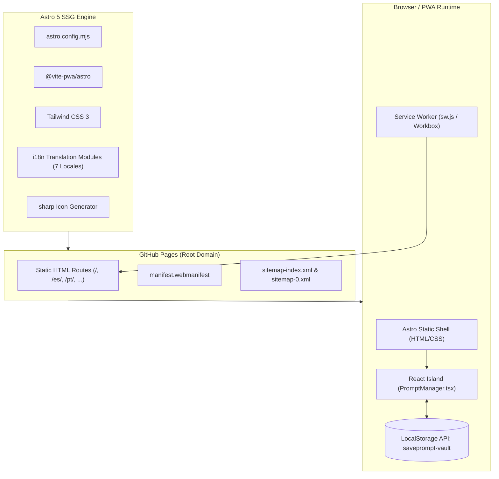

<div align="center">

# SavePrompt | Minimalist AI Prompt Saver

**An ultra-fast, 100% client-side Progressive Web App (PWA) to instantly capture, organize, search, and copy AI prompts.**  
*Zero server dependencies • Zero tracking • Complete local privacy • Offline-first architecture*

[](https://saveprompt.github.io/)
[](https://ko-fi.com/kishara)

<br />

[](https://astro.build/)
[](https://react.dev/)
[](https://tailwindcss.com/)
[](https://www.typescriptlang.org/)
[](https://saveprompt.github.io)
[](https://saveprompt.github.io)
[](./LICENSE)

</div>

---

## 📖 Table of Contents

- [Overview & Vision](#-overview--vision)
- [Key Features](#-key-features)
- [System Architecture](#-system-architecture)
- [Design System & Palette](#-design-system--palette)
- [Internationalization (i18n)](#-internationalization-i18n)
- [Technical SEO & Analytics](#-technical-seo--analytics)
- [Project Structure](#-project-structure)
- [Getting Started](#-getting-started)
- [Available Scripts](#-available-scripts)
- [Keyboard Shortcuts](#-keyboard-shortcuts)
- [Privacy & Security](#-privacy--security)
- [Deployment](#-deployment)
- [Support the Developer](#-support-the-developer)
- [License](#-license)

---

## 🌟 Overview & Vision

Modern Large Language Models (LLMs)—including ChatGPT, Claude, Gemini, DeepSeek, and Midjourney—require high-quality, reusable prompts. However, existing prompt management solutions often require accounts, cloud logins, or invasive tracking scripts.

**SavePrompt** was created to be the cleanest, fastest, and most private prompt saver on the web:
- **Instantaneous Entry**: Paste, tag, and hit save in under two seconds.
- **100% Local Privacy**: Prompts never leave your browser. Zero cloud sync, zero databases, and zero tracking.
- **True Offline PWA**: Installable natively on iOS, Android, macOS, Windows, and Linux with full offline capability.
- **Portable Backups**: Export your entire prompt vault to a clean JSON file and restore it on any device with automatic deduplication.

---

## ✨ Key Features

| Feature | Description |
|---|---|
| **⚡ Rapid Entry Interface** | Auto-focused textarea with live character counter, tag input, and `Ctrl/Cmd + Enter` quick save shortcut. |
| **📋 1-Click Clipboard Engine** | Instant copying with visual success confirmation (`Copied!`) and cross-browser fallbacks. |
| **🔍 Instant Real-Time Search** | Client-side search filtering simultaneously across prompt text and associated tags as you type. |
| **🏷️ Interactive Tag Pills** | Dynamic tag pills displaying prompt count badges; click to isolate tags instantly. |
| **📴 Offline PWA Support** | Intercepts `beforeinstallprompt` with a custom `[+]` button in the navbar for native installation. |
| **💾 Local JSON Vault Backup** | One-click export to `saveprompt-YYYY-MM-DD.json` and schema-validated import with deduplication. |
| **🎨 Minimalist Light & Dark Mode** | Crafted color palette (`#FCF0DA`, `#AEAC78`, `#F2C46A`, `#4C4541`) with WCAG AAA contrast (10.8:1). |
| **🌐 7-Language Localization** | Native subpath routing (`/`, `/es/`, `/pt/`, `/de/`, `/fr/`, `/ja/`, `/zh/`) with complete UI and SEO dictionaries. |
| **🚀 100% Technical SEO** | Valid `WebApplication`, `HowTo`, `FAQPage`, and `BreadcrumbList` JSON-LD schemas with Google Analytics `gtag.js`. |

---

## 🏗️ System Architecture



### Architectural Decisions

1. **Static Site Generation (SSG) with Astro 5**:
   Delivers pre-rendered HTML for instant First Contentful Paint (FCP) and optimal search engine crawlability across all 7 language routes.
2. **React 19 Islands Architecture**:
   Interactive functionality is encapsulated in a single, lightweight React Island (`PromptManager.tsx`), loading only the JavaScript needed for local state, search, and clipboard management.
3. **PWA & Offline Service Worker (`@vite-pwa/astro`)**:
   Generates a production Service Worker utilizing `StaleWhileRevalidate` for document pages and static assets, and `CacheFirst` for images and icons.
4. **LocalStorage Persistence**:
   Zero network latency. All prompts are persisted under the key `saveprompt-vault` with graceful JSON parsing and cross-tab synchronization.

---

## 🎨 Design System & Palette

SavePrompt uses an intentional, distraction-free color palette built with warm earth tones and charcoal neutrals:

```
┌────────────────────────────────────────────────────────────────────────┐
│  #FCF0DA          #AEAC78          #F2C46A          #4C4541            │
│  Soft Cream       Muted Sage       Warm Amber       Deep Charcoal      │
│  (Canvas/Bg)      (Borders/Tags)   (Primary CTAs)   (Text/Surfaces)    │
└────────────────────────────────────────────────────────────────────────┘
```

| Token | Hex | RGB | Light Theme Usage | Dark Theme Usage | WCAG Ratio |
|---|---|---|---|---|:---:|
| **Soft Cream** | `#FCF0DA` | `rgb(252, 240, 218)` | Canvas background | High-contrast glowing typography | **10.8:1** (AAA) |
| **Deep Charcoal** | `#4C4541` | `rgb(76, 69, 65)` | Primary typography & icons | Elevated surface canvas | **10.8:1** (AAA) |
| **Warm Amber** | `#F2C46A` | `rgb(242, 196, 106)` | Primary buttons (Save, Copy) | Primary action buttons & accents | **7.6:1** (AAA) |
| **Muted Sage** | `#AEAC78` | `rgb(174, 172, 120)` | Secondary borders & tag chips | Secondary borders & tag chips | Compliant |

---

## 🌐 Internationalization (i18n)

SavePrompt supports 7 major languages out of the box using Astro subpath routing. All UI text, placeholders, FAQs, How-To steps, and SEO metadata are completely localized:

| Language | Code | Badge | Canonical Route | Status |
|---|:---:|:---:|---|:---:|
| **English** | `en` | `US` | `https://saveprompt.github.io/` | Default |
| **Español** | `es` | `ES` | `https://saveprompt.github.io/es/` | Complete |
| **Português** | `pt` | `BR` | `https://saveprompt.github.io/pt/` | Complete |
| **Deutsch** | `de` | `DE` | `https://saveprompt.github.io/de/` | Complete |
| **Français** | `fr` | `FR` | `https://saveprompt.github.io/fr/` | Complete |
| **日本語** | `ja` | `JP` | `https://saveprompt.github.io/ja/` | Complete |
| **简体中文** | `zh` | `CN` | `https://saveprompt.github.io/zh/` | Complete |

Every page includes bidirectional `<link rel="alternate" hreflang="..." />` tags pointing to all 7 languages plus `x-default`.

---

## 🚀 Technical SEO & Analytics

SavePrompt is engineered to achieve a **100/100 technical SEO score** based on Google Search Central Essentials:

- **Google Analytics 4**: Integrated via `gtag.js` (`G-Y5EW9FEW56`) with a `preconnect` resource hint to prevent render blocking.
- **Structured Data (JSON-LD)**: 100% white-hat structured markup without deceptive rating aggregations:
  - `WebApplication`: Declares software category, operating system compatibility, author, publisher, screenshots, and feature list.
  - `HowTo`: 4 structured instructional steps for saving and copying prompts.
  - `FAQPage`: 4 rich Q&A entities addressing tool definition, privacy, offline access, and backups.
  - `BreadcrumbList`: Multi-tier hierarchical breadcrumbs for search engine crawlers.
- **Social Graph Optimization**:
  - Open Graph (`og:type`, `og:title`, `og:description`, `og:url`, `og:image`).
  - Pre-rendered 1200 × 630 px social card (`/og-image.png`).
  - Twitter Cards with `summary_large_image`.
- **Indexing Directives**:
  - `robots.txt` granting access to all search engines and referencing the XML sitemap index.
  - `sitemap-index.xml` and `sitemap-0.xml` with complete cross-referenced hreflang annotations.

---

## 📁 Project Structure

```text
saveprompt.github.io/
├── .github/
│   └── workflows/
│       └── deploy.yml          # GitHub Pages CI/CD deployment pipeline
├── public/
│   ├── icons/
│   │   ├── icon-192x192.png    # PWA standard icon
│   │   └── icon-512x512.png    # PWA high-res & maskable icon
│   ├── 404.html                # Custom fallback error page
│   ├── apple-touch-icon.png    # iOS home screen icon
│   ├── favicon.svg             # Minimalist SVG vector favicon
│   ├── og-image.png            # 1200x630 Open Graph preview image
│   ├── registerSW.js           # Service Worker registration script
│   └── robots.txt              # Search engine crawler directives
├── scripts/
│   └── generate-icons.js       # Node + sharp automated icon builder
├── src/
│   ├── components/
│   │   ├── Footer.astro        # Responsive footer with privacy & support links
│   │   ├── Navbar.astro        # Sticky navigation with language selector & PWA prompt
│   │   └── PromptManager.tsx   # React Island: vault state, search, tags & clipboard
│   ├── hooks/
│   │   └── useLocalStorage.ts  # SSR-safe, cross-tab synchronized storage hook
│   ├── i18n/
│   │   ├── de.json             # German translations
│   │   ├── en.json             # English translations (default)
│   │   ├── es.json             # Spanish translations
│   │   ├── fr.json             # French translations
│   │   ├── ja.json             # Japanese translations
│   │   ├── pt.json             # Portuguese translations
│   │   ├── zh.json             # Simplified Chinese translations
│   │   └── index.ts            # Translation helper & type definitions
│   ├── layouts/
│   │   └── Layout.astro        # Root HTML layout with SEO meta, gtag, & theme script
│   ├── pages/
│   │   ├── de/index.astro      # German localized route
│   │   ├── es/index.astro      # Spanish localized route
│   │   ├── fr/index.astro      # French localized route
│   │   ├── ja/index.astro      # Japanese localized route
│   │   ├── pt/index.astro      # Portuguese localized route
│   │   ├── zh/index.astro      # Chinese localized route
│   │   └── index.astro         # English root route (/)
│   └── styles/
│       └── global.css          # Tailwind base directives & custom scrollbars
├── astro.config.mjs            # Astro, React, Tailwind, Sitemap & PWA configuration
├── package.json                # Project dependencies & build scripts
├── tailwind.config.mjs         # Tailwind palette tokens & animation configuration
└── tsconfig.json               # TypeScript strict configuration & path aliases
```

---

## 💻 Getting Started

### Prerequisites

- [Node.js](https://nodejs.org/) `>= 20.0.0`
- [npm](https://www.npmjs.com/) `>= 9.0.0` (or `pnpm` / `bun`)

### 1. Clone the Repository

```bash
git clone https://github.com/saveprompt/saveprompt.github.io.git
cd saveprompt.github.io
```

### 2. Install Dependencies

```bash
npm install
```

### 3. Launch Development Server

```bash
npm run dev
```

Navigate to `http://localhost:4321` in your browser. The server supports instant hot-module replacement (HMR).

### 4. Build for Production

```bash
npm run build
```

This triggers `prebuild` (generating all icons and the Open Graph card), followed by Astro static compilation, Vite client bundling, Service Worker generation, and XML sitemap compilation into `dist/`.

### 5. Preview Production Build Locally

```bash
npm run preview
```

---

## ⚡ Available Scripts

| Command | Action |
|---|---|
| `npm run dev` | Starts the Astro development server at `localhost:4321`. |
| `npm run prebuild` | Generates high-res PWA icons and the 1200×630 Open Graph social card via `sharp`. |
| `npm run build` | Runs `prebuild` and compiles the complete static production build to `/dist`. |
| `npm run preview` | Spins up a local static web server to test the `/dist` production build. |

---

## ⌨️ Keyboard Shortcuts

| Shortcut | Context | Action |
|---|---|---|
| `Ctrl + Enter` / `Cmd + Enter` | Prompt Input Textarea | Save the current prompt immediately |
| `Escape` | Search Bar | Clear active search query |
| `Tab` | Global Navigation | Full accessible keyboard focus navigation |

---

## 🔒 Privacy & Security

SavePrompt is engineered under a strict **Zero-Knowledge, Zero-Server** privacy guarantee:

1. **Local Data Isolation**: Prompts are stored exclusively in your browser's `localStorage` (`saveprompt-vault`).
2. **Zero Backend APIs**: The application makes no database calls, no telemetry calls, and transmits no prompt content over the wire.
3. **No Third-Party Cookies**: No advertising identifiers, session trackers, or third-party tracking cookies are used.
4. **Data Ownership**: You can export your data to an unencrypted, open `.json` file at any time and wipe your local browser cache whenever you choose.

---

## 🚀 Deployment

The project is configured for continuous static deployment to **GitHub Pages** via GitHub Actions:

- Every push to the `main` branch triggers `.github/workflows/deploy.yml`.
- The workflow provisions Node 20, executes `npm ci`, runs `npm run build`, and deploys the resulting `dist/` directory directly to GitHub Pages.

To deploy your own fork:
1. Fork this repository.
2. Go to **Settings > Pages** in your GitHub repository.
3. Under **Build and deployment > Source**, select **GitHub Actions**.
4. Push to `main` to trigger the automated deployment.

---

## ☕ Support the Developer

SavePrompt is free and open-source software built for the AI developer and creator community. If SavePrompt makes your daily workflow easier, consider supporting ongoing maintenance:

👉 **[Support on Ko-fi](https://ko-fi.com/kishara)**

---

## 📄 License

Distributed under the **MIT License**. See [`LICENSE`](./LICENSE) for more information.

---

<div align="center">
  <small>Made with ♥ for the global AI community • Designed for speed, privacy, and simplicity.</small>
</div>
